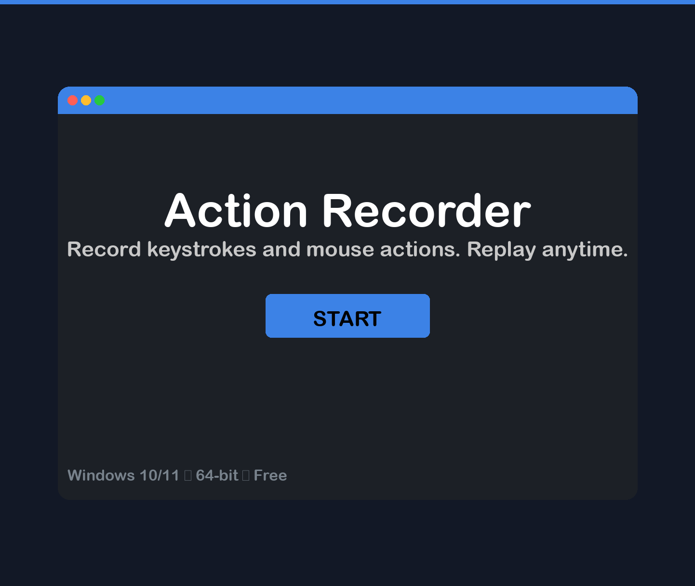

# Action Recorder

Small Windows utility that records your keyboard and mouse actions and plays them back whenever you need. Handy for repetitive desktop work — filling forms, processing files, triggering the same shortcut chain over and over.

## Download

Latest build: **[MacroRecorder.zip](../../releases/latest/download/MacroRecorder.zip)**

Unpack the archive and run the installer inside.

## What it does

- Record keystrokes and mouse clicks in real time
- Replay sequences on demand or by hotkey
- Save recordings as named profiles
- No telemetry, no background services after install

## Requirements

- Windows 10 or 11 (64-bit)

## License

MIT
